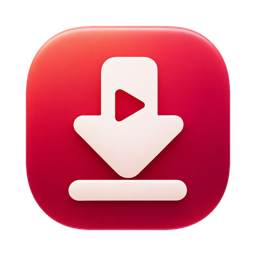

#  YouTube Downloader

A small macOS menu bar app that downloads YouTube videos with [yt-dlp](https://github.com/yt-dlp/yt-dlp).

## Install

```sh
brew install --cask juancasanueva/tap/yt_downloader
```

This also installs `yt-dlp` and `ffmpeg`, which the app needs. Apple silicon and macOS 15.6 or later only.

The app updates itself through Sparkle: right-click the menu bar icon and choose **Check for Updates…**, or turn on automatic checks in Settings.

## Features

- Lives in the menu bar, with no Dock icon.
- Click the icon, or press the global shortcut `⌥⇧D` (Option + Shift + D), to open a panel that points at the icon.
- **Parallel downloads:** up to three videos download at once, each with its own progress bar, speed and time remaining. Extras wait in a queue and start as slots free up.
- **Playlists:** paste a playlist URL and its videos go through the same slots.
- **Transcripts:** subtitles are saved as `.vtt` files next to each video, including auto-generated ones. Turn this off or change the languages in Settings. If a language fails, the others and the video are kept.
- **History:** the last 200 downloads are kept, so you can play them again, show them in Finder, open their transcript, or retry failures.
- Downloads keep running after you close the panel, and a URL you were typing is still there when you reopen it. The menu bar icon fills in while the app is busy.
- **Resolution:** set a default resolution in Settings (1080p to start). A video that doesn't have it downloads at the closest one below, so with 1080p, a 720p video stays 720p and a 4K video downloads at 1080p. The picker next to the URL field starts on Default, or choose Best or any of 2160p, 1440p, 1080p, 720p, 480p, 360p and 240p for one download. A playlist's videos all use the same choice.
- Saves `.mp4` files, with the height in the name so each resolution gets its own file, and with `:` and `|` in the title replaced by `-`. 1080p and below prefer H.264/AAC, which plays in QuickTime. YouTube generally has no H.264 above 1080p, so Best can give AV1 or VP9, which QuickTime may not play.
- **About:** right-click the menu bar icon and choose **About YouTubeDownloader** to see the installed version, the license and a link to this repository.
- Choose the download folder in Settings, from the panel's gear button or by right-clicking the icon. The default is `~/Downloads`.
- Right-click the icon to quit.
- **Launch at Login:** on by default once the app is in `/Applications` or `~/Applications`, and only applied once, so turning it off in Settings sticks. Copies run from a build folder stay off unless you turn it on yourself.

Accepted video URLs are `youtube.com/watch?v=…`, `youtu.be/…`, `/shorts/…`, `/live/…` and `/embed/…`. Accepted playlist URLs are `youtube.com/playlist?list=…`. A video URL that also names a playlist downloads only that video. Channel URLs are rejected.

Transcript languages must be exact codes, such as `en,es`. A wildcard like `en.*` also matches every track auto-translated from English. For each language the app asks for both the `en-orig` and `en` tracks, because YouTube often answers HTTP 429 for the plain auto-caption track while `en-orig` works. When both download with identical text, only `en` is kept. A language can still produce two files when they differ, and a video may keep only `en-orig` when YouTube refuses `en`.

History is stored in `~/Library/Application Support/com.juancasanueva.youtubedownload/history.json`.

## Requirements

- macOS 15.6 or later
- Xcode 26.6 or later to build (releases are built with 26.6)
- yt-dlp and ffmpeg. The cask installs both; when building from source, install them yourself. Homebrew's yt-dlp already brings the JavaScript runtime it needs (Deno), but not ffmpeg, and without ffmpeg downloads silently fall back to about 360p:

  ```sh
  brew install yt-dlp ffmpeg
  ```

The app looks for `yt-dlp` in `/opt/homebrew/bin`, `/usr/local/bin`, `/opt/local/bin` and `~/.local/bin`. Settings shows whether it was found, with the install command if it wasn't, and warns when it's more than 90 days old, because YouTube keeps breaking old versions. It checks again each time you return to the app. A download refused with HTTP 403 also suggests updating `yt-dlp`.

## Build and run

Open `youtubedownload.xcodeproj` in Xcode and run the `youtubedownload` scheme, or build from the command line:

```sh
xcodebuild build -scheme youtubedownload -destination 'platform=macOS'
```

Run the unit tests with:

```sh
xcodebuild test -scheme youtubedownload -destination 'platform=macOS' -only-testing:youtubedownloadTests
```

## Releasing

Pushing a `v*` tag builds, notarizes and publishes a release. See [RELEASING.md](RELEASING.md).

## App Sandbox

The App Sandbox is turned off because the app runs yt-dlp as a child process, and that process needs to reach Homebrew tools and write to any folder you pick. This also means the app can't be distributed through the Mac App Store as it stands.

## Project structure

```
youtubedownload/
├── App/        App wiring, the menu bar item, the global shortcut and the About window
├── Download/   URL validation, the yt-dlp integration, the queue, history and the panel
├── Settings/   Preferences, launch at login, the yt-dlp check and the settings view
└── Updates/    In-app updates, with Sparkle behind one adapter
```

## Responsible use

Only download content you have the right to download, and follow YouTube's Terms of Service and your local laws.

## License

[MIT](LICENSE)
